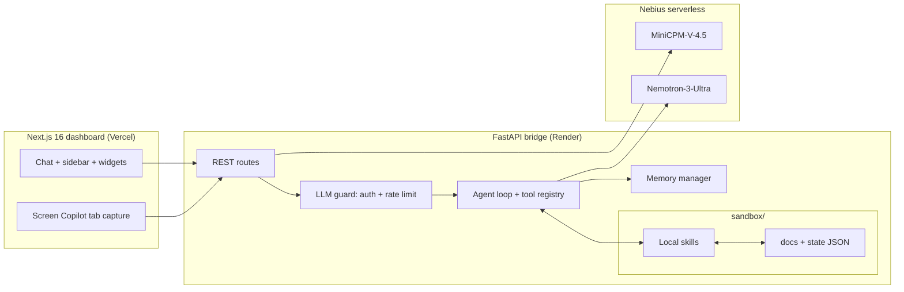

# SAGE — Student Assistant for Growth and Education

SAGE is an always-on, privacy-first personal AI companion for a university student. It runs a tool-calling agent on NVIDIA Nemotron (Nebius serverless inference) that talks naturally, tracks nutrition and macros, manages schedules and reminders, searches a private PDF notes library with RAG, watches the screen with a live vision copilot, and renders custom tracking widgets on the dashboard.

- **Frontend**: Next.js 16 (App Router) dashboard — deployed on Vercel
- **Backend**: FastAPI bridge with a local skills layer — deployed on Render
- **Inference**: Nebius serverless — `Nemotron-3-Ultra` for chat, `MiniCPM-V-4.5` for vision
- **Sandboxing**: NVIDIA OpenShell / NemoClaw wrap the process at the infrastructure layer

## Features

| | |
|---|---|
| **Conversational agent** | Function-calling agent loop with capped tool rounds; replies stay conversational and never leak raw tool output |
| **Macro tracking** | Log meals with portion-anchored estimates, correct past entries, query daily totals — calories and protein against daily targets |
| **Schedule & reminders** | Relative phrasing ("remind me in 17 minutes"), absolute events, and one-shot timetable imports; native browser notifications fire 15 min before classes and at reminder time |
| **Notes library (RAG)** | Search across personal PDFs and markdown notes; results are injected as delimited, sanitized context |
| **Live Screen Copilot** | One VLM pass per captured tab frame — extracts course/topic/due dates into the schedule, saves study notes into the RAG index, and answers questions about the current screen |
| **Code interpreter** | Sandboxed subprocess with a static AST import allowlist (`math`, `numpy`, `sympy`, `scipy`, `matplotlib`) for exact math and plots |
| **Web search** | Grounded DuckDuckGo search with inline citations when the local library can't answer |
| **Dynamic widgets** | The agent creates and updates sidebar cards (`list`, `comparison`, `progress`, `stat`) for arbitrary metrics — scores, habits, budgets |
| **Persistent memory** | Every turn is stored; older turns are folded into a compressed summary injected as `[Prior Session Memory]` |

## Architecture



**Project structure**

```text
.
├── backend/            # FastAPI app: routes, schemas, services, config
│   └── app/services/   # sage_brain (agent), memory, widgets, tab analyzer
├── frontend/           # Next.js dashboard (App Router)
│   └── src/components/ # Chat UI, widget cards, hero
├── skills/             # Local skills: macro_tracker, rag_reader,
│                       # schedule_manager, code_interpreter, web_search,
│                       # daily_summary, sandbox_guard
├── sandbox/            # The only writable area: docs/, state/, calendar/
├── scripts/            # security_checks.py, sample data
└── start_servers.sh    # Detached local launcher (backend + dashboard)
```

## Getting started

### Prerequisites

- Python 3.12+ (repo uses 3.14) with a virtualenv at the repo root (`venv/`)
- Node.js 20.9+ and npm
- A [Nebius](https://studio.nebius.ai/) API key

### 1. Configure environment

Create `.env` at the repo root:

```ini
NEBIUS_API_KEY=nvidia-key-...
NEBIUS_BASE_URL=https://api.studio.nebius.ai/v1
MODEL_ID=nvidia/Nemotron-3-Ultra-550b-a55b
```

Optional overrides: `JUDGE_DEMO_TOKEN` (demo access token), `JUDGE_SESSION_CAP` (default `50`).

### 2. Backend

Run from the repo root venv with `backend/` as the working directory (so `../.env` and the root `skills/` resolve):

```bash
cd backend
../venv/bin/pip install -r requirements.txt
../venv/bin/uvicorn app.main:app --reload --port 8001
```

### 3. Frontend

```bash
cd frontend
npm install
npm run dev
```

Open http://localhost:3000. Point the dashboard at a custom backend with `NEXT_PUBLIC_API_URL` (build-time env in `frontend/`); when unset it falls back to the public Render deploy, then to the local `127.0.0.1:8001`.

### One-command dev

```bash
npm run dev        # or: bash start_servers.sh
```

Starts both servers as detached daemons, builds the dashboard if needed, waits for health, and is idempotent — already-running services are skipped. Logs land in `logs/`.

> [!TIP]
> If the dashboard shows **SAGE OFFLINE**, start the backend first and check `logs/backend.log`. The chat and screen-copilot endpoints are gated: enter the demo token (or a Nebius key) in the banner shown in the dashboard corner.

## API reference

| Method | Path | Description |
|---|---|---|
| `GET` | `/health` | Service health and version |
| `POST` | `/api/chat` | Main bridge: `{messages: [{role, content}]}` → `{reply, state}`; `state` carries `macros`, `schedule`, `documents`, `widgets` |
| `GET` | `/api/state` | Current agent state snapshot |
| `GET` | `/api/history` | Persisted conversation turns (dashboard restore) |
| `DELETE` | `/api/history` | Wipe chat history and compressed summary |
| `POST` | `/api/screen/analyze` | Screen Copilot: `{frame_base64, question?}` — one VLM pass per frame; frames are decoded in memory and never persisted |
| `GET` | `/api/summary/daily` | LLM-generated daily briefing (deterministic fallback if the LLM is unreachable) |
| `GET`/`POST`/`DELETE` | `/api/widgets`, `/api/widgets/update`, `/api/widgets/{id}` | Dynamic widget store (persistence in `sandbox/state/widgets.json`) |

Client timezone is sent per request via the `X-User-Timezone` header so reminder math and "what time is it" answers match the browser clock.

## Agent tools

`log_macros`, `edit_macro_entry`, `add_schedule_item`, `manage_schedule`, `search_docs`, `run_python_interpreter`, `web_search`, and `update_user_widget` are implemented as local skills and dispatched by the agent loop in `backend/app/services/sage_brain.py`. Search calls are capped per turn so context never loops, and PDF/tool results are always wrapped as untrusted data.

## Judge / demo access

The LLM-burning endpoints (`POST /api/chat`, `POST /api/screen/analyze`) are gated. A request must carry either:

- `X-Judge-Token` — the shared demo token (env `JUDGE_DEMO_TOKEN`, default `JUDGE_DEMO_2026`), capped at `JUDGE_SESSION_CAP` queries per session, or
- `X-Nebius-Api-Key` — bring-your-own-key, uncapped.

Everything else stays open. A per-IP limit of **10 requests/min** spans the gated endpoints.

## Security model

- **Filesystem containment**: every skill file operation is resolved and checked against `sandbox/` (`skills/sandbox_guard.py`); traversal and absolute escapes raise `ValueError` before any read/write.
- **Prompt-injection defense**: extracted PDF text is sanitized (control chars stripped, angle brackets HTML-escaped), LLM-facing tool results are wrapped in `<tool_results>` / `<document_context>` delimiters, and the system prompt treats all such content as untrusted data. The agent loop is hard-capped at 3 rounds.
- **API hardening**: CORS allows all origins (wildcard) with permissive methods/headers, all 5xx responses are generic, and stack traces or secrets stay in the server log only. Chat payloads are length-limited via Pydantic.
- **Code interpreter**: subprocess sandboxing with a static AST import allowlist and captured output.

Verify all of the above:

```bash
venv/bin/python scripts/security_checks.py
```

## Deployment

- **Backend** — FastAPI on [Render](https://render.com), public at `https://sage-c6au.onrender.com`. Set `NEBIUS_API_KEY` (and optionally `JUDGE_DEMO_TOKEN`) in the Render environment.
- **Frontend** — Next.js on [Vercel](https://vercel.com). Set `NEXT_PUBLIC_API_URL=https://sage-c6au.onrender.com` so the dashboard targets the deployed backend instead of falling back.

> [!NOTE]
> The frontend bakes `NEXT_PUBLIC_API_URL` in at build time — redeploy after changing it.
